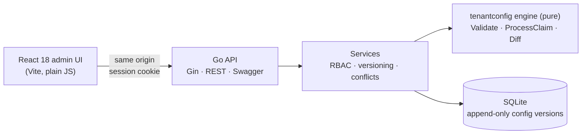

# Multi-Tenant Claim Configuration Platform

Solution to **Papaya AI Engineering Challenge 15**. An insurance platform where each insurer (tenant) gets its own claim-processing behaviour (claim types, required documents, approval tiers, notifications, SLA, custom fields) purely through configuration. An operations user onboards a new insurer by filling in a form, with **zero code changes**.

## Try it

| | |
|---|---|
| **Live admin UI** | **https://papaya-2ze0.onrender.com** |
| **API docs (Swagger)** | https://papaya-2ze0.onrender.com/swagger/index.html |
| **Login** | `admin@papaya.com` / `123456` (full access) |
| Other roles | `operator@papaya.com` / `Operator@2026` (manage tenants, process claims) · `viewer@papaya.com` / `Viewer@2026!` (read-only) |
| **5-minute walkthrough** | [DEMO.md](DEMO.md): create a tenant → configure it → process claims → compare configs |

> Hosted on Render's free tier: the first request after a quiet period can take **up to a minute** while the server wakes up. The demo database resets to the seed data whenever the server restarts.

## What it does

Three insurers are seeded, as specified in the challenge: **SafeGuard** (corporate), **HealthFirst** (retail) and **GovHealth** (government). The same claim (*Outpatient, 15,000, submitted on a Friday*) produces three different outcomes:

| | SafeGuard | HealthFirst | GovHealth |
|---|---|---|---|
| Approval | **Auto-approved** (below 20,000) | **Assessor** (tier 5,000–50,000) | **Committee** (every claim reviewed) |
| Notifications | Email (submitted + approved) | Email + SMS | Email + webhook |
| SLA deadline | +5 business days | +7 business days | +15 business days |
| Required custom fields | Employee ID | none | Department, Budget Code |

### Requirements coverage

| Challenge requirement | Implementation |
|---|---|
| Tenant config: branding, claim types and documents, approval tiers, notifications, SLA and escalation, custom fields | One typed config per tenant, edited in a sectioned form with a live logo/branding preview |
| **Validation** (threshold ≥ 0, at least one claim type, positive SLA, …) | Server-side validation with field-level messages shown inline while typing. Saving is blocked until the config is valid. The rules go beyond the brief: contiguous tiers, an SLA for every enabled type, a webhook URL when the webhook channel is used, valid regex patterns |
| **Preview mode** | Same engine as runtime. Previews one claim against several tenants, or against an **unsaved** config while editing, with a step-by-step explanation of each decision |
| **Config diff** | Two tenants, or two versions of one tenant, compared side by side. Lists are compared as sets; tiers are matched by role and custom fields by key |
| **Config history and rollback** | Every save is a new immutable version. Rollback creates a new version, so history is never rewritten. Concurrent edits are detected (`VERSION_CONFLICT`) |
| `processClaim(tenantId, claimData)` | `POST /api/v1/claims/process` returns required and missing documents, approval routing (tier and role), notifications per channel, the SLA deadline in business days in the tenant's time zone, and custom-field validation. Processed claims are stored with the config version used |
| **4th tenant with zero code changes** | Created through the UI (or API) from a default config. Covered by an automated end-to-end test |
| **Modular**: a new dimension such as currency needs minimal changes | Each config section is a self-contained module: backend `Validate` / `Process` / `DiffKeys`, plus one frontend form section. Adding one means one new file per side and one registration line each |

Also included:
- Role-based access: admin, operator and viewer, checked by permission code on every endpoint and screen.
- Session login with lockout after repeated failures.
- Vietnamese and English UI and messages.
- A dashboard, a searchable insurer list, Ctrl+S to save, and light and dark themes.

## Architecture



- **One engine, used by preview and runtime alike.** `component/tenantconfig` is pure Go with no I/O. Six modules (branding, claim types, custom fields, approval, SLA, notifications) each validate their own section and contribute their part of the claim result. Preview and runtime call the same `ProcessClaim`, so a preview always matches the real outcome.
- **History you can trust.** Database triggers make `tenant_config_version` append-only with gap-free version numbers. A deferred foreign key keeps `tenant.current_version` pointing at a real version, and a stale save is rejected instead of overwriting someone else's change.
- **Single deployable.** The Go binary serves the built UI, the API and Swagger from one origin. One Docker image is built from the [Dockerfile](Dockerfile): Vite build → static Go binary → Alpine.
- **Uniform API contract.** Every endpoint returns `{code, message, error_text, data[]}`, with stable error codes and translated text. See the [API reference](workspace/backend/API_DOCUMENT.md).

| Layer | Stack |
|---|---|
| Frontend | React 18, Vite, React Router, i18next. Plain JavaScript and CSS modules, no UI or state libraries |
| Backend | Go, Gin, sqlx, swaggo (Swagger), bcrypt sessions |
| Database | SQLite (`modernc.org/sqlite`, no CGO) with embedded migrations; Turso-ready via `DATABASE_URL` |
| Tests | Go `testing` + `httptest`, Vitest + Testing Library + MSW, Playwright |
| Deploy | Docker, Render |

## Run locally

```bash
docker compose up --build            # http://localhost:8080  (data kept in a Docker volume)
```

Without Docker (Go 1.27+, Node 24+):

```bash
cd workspace/frontend && npm ci && npm run build
cd ../backend && STATIC_DIR=../frontend/dist go run .      # http://localhost:8080
```

On first start the server creates the SQLite database, runs migrations and seeds the three insurers and the demo accounts. To automate the walkthrough from the command line, run `workspace/backend/scripts/demo.sh [base-url]`.

## Tests

| Suite | What it covers | Command |
|---|---|---|
| Go: 25 test functions / 50 cases | The engine: the same claim → 3 tenants, tier boundaries, rejections, business days. Validation rules, diff semantics, version-conflict handling. HTTP integration tests against a real temporary SQLite database: auth, permissions, CSRF guard, onboarding, history, rollback, preview. i18n completeness | `cd workspace/backend && go test ./...` |
| Frontend: 37 tests | Login and permissions, live validation, onboarding a 4th tenant, save and conflict, preview, diff, rollback, dashboard, search, Ctrl+S, logo fallback, translation parity | `cd workspace/frontend && npm test` |
| End-to-end: 3 scenarios | Real browser against the real stack: identical claims → different outcomes; onboard and process a 4th tenant; save → rollback → diff | `E2E_BASE_URL=http://localhost:8080 npm run e2e` |

## Repository guide

```
Dockerfile, docker-compose.yml   single-image build and local run
DEMO.md                          walkthrough (UI and API) with real output
PLAN-challenge15.md              requirements analysis, assumptions, design, plan (Vietnamese)
PLAN-backend.md                  backend design notes (Vietnamese)
workspace/backend/               Go API: component/{models,repositories,services,handlers/rest,tenantconfig}, migrations/, seed/
workspace/frontend/              React admin: src/{api,auth,pages,pages/tenant-sections,tenant,components,locales}
CLAUDE.md (+ per-project)        working agreement and architecture notes used by the AI coding assistant
```

## Assumptions

The brief leaves some points open; these are the choices made. The full list is in section 10 of [PLAN-challenge15.md](PLAN-challenge15.md) (the planning notes are in Vietnamese).

- **Tier boundaries:** tiers are half-open ranges `[min, max)`. The auto-approval threshold is the single source of truth, and the first tier starts at it. Tier amounts not given in the brief were chosen, e.g. SafeGuard 20k–100k assessor, 100k–500k team lead, 500k+ director.
- **Business days:** Monday to Friday in the tenant's time zone, with no public holidays. A weekend submission starts counting on Monday.
- **Notifications:** `processClaim` reports the notifications due at submission, which is *claim submitted*, plus *approved* when the claim is auto-approved.
- **Missing documents and invalid claims:** missing required documents are reported but do not reject a claim. A claim type the tenant does not offer, or invalid custom fields, returns a rejected result with reasons.
- **Deletion:** deleting a tenant archives it, and its history stays readable.

## How it was built

This challenge is about directing an AI coding tool. The project was built with **Claude Code**:
- I broke the brief down into written plans first (`PLAN-*.md`), and the AI implemented them phase by phase.
- Conventions (layering, API envelope, i18n, testing style) were fixed up front in `CLAUDE.md` and project skills.
- Every phase was checked by running the tests, the end-to-end suite and screenshots of the real UI, not by reading the generated code alone. This caught real bugs, such as state leaking between routes, a cached-image race in the logo preview, and mobile overflow.

---

Built by **Minh Quan**: [github.com/quanngo](https://github.com/quanngo)
